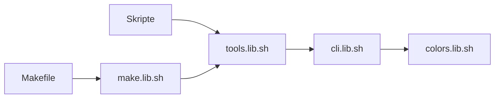

# Qualitätsprofil

Woran man in diesem Projekt ein gutes Ergebnis erkennt, auch wo kein Werkzeug
misst. Maßstab für den Qualitätslauf am Sprintende und für den Reviewer
(Guard `quality`, Bericht ist Pflicht). Ein Konzeptticket, das den Aufbau
ändert, gleicht es ab.
Leere Abschnitte heißen „noch nicht entschieden“; „keine“ ist eine Entscheidung.
Eine Aussage mit „nur“ oder „nie“ nennt, was sie durchsetzt (Test, Lint-Regel);
ohne das ist sie eine Konvention. Steht eine Regel schon in den Projektregeln
(`AGENTS.md`), verweist das Profil auf den Abschnitt, statt sie zu wiederholen.

Werte aus den Einstellungen und Regeln aus dem Workflow stehen hier nicht. Das
Profil nennt ihren Schlüssel; den wirksamen Wert zeigt `get_config`.

## Übersicht

- [Messbare Grenzen](#messbare-grenzen)
- [Aufbau und Zuständigkeiten](#aufbau-und-zuständigkeiten)
- [Eine Quelle je Wissen](#eine-quelle-je-wissen)
- [Tests](#tests)
- [Fehler und Ausgaben](#fehler-und-ausgaben)
- [Dokumentation](#dokumentation)
- [Bewusste Ausnahmen](#bewusste-ausnahmen)

## Messbare Grenzen

`make check` ist der volle Prüflauf; wann er läuft, regeln die Regel
`gezielte-tests` und der Schlüssel `testing.enabled`. Für Komplexität, Dateigröße
und doppelten Code gibt es kein Werkzeug; das bewertet der Reviewer (Guard `dry`).

| Prüfung | Quelle der Grenze | Bricht den Lauf |
|---|---|---|
| Doku gegen das Projekt | `.docs-check.conf.sh`: `DOCS`, `FORBIDDEN`, `MAX_ALERTS`, `TRANSLATIONS` | Probleme ja, Hinweise nein |
| ShellCheck ohne Meldung | `FILES` in `test/_testShellcheck.sh` | ja; ohne installiertes `shellcheck` übersprungen |
| Breite von `make help` | `test/_testMakeInstall.sh` | ja |
| Bash-Mindestversion | `src/cli.lib.sh`, `test/_testBashVersion.sh` | ja |
| Bash-Tests | `test/testAll.sh` startet alle `test/_test*.sh` | ja |

`FILES` umfasst nicht alle Bibliotheken. Was fehlt, etwa `docker.lib.sh`, ist
keine Ausnahme mit Grund, sondern noch nicht entschieden.

[↑ Übersicht](#übersicht)

## Aufbau und Zuständigkeiten

Die Einbindung läuft in eine Richtung; `test/_testLibLayout.sh` prüft die
Aufteilung.

| Ort | Gehört dorthin |
|---|---|
| `cli.lib.sh` | Ausgabe im CLI-Theme |
| `colors.lib.sh` | feste Farbpalette |
| `tools.lib.sh` | Allzweck-Helfer; lädt die Grundbibliotheken |
| `make.lib.sh` | Hilfe, Hinweise und Installation für Makefiles |
| `Makefile` | Einstiegspunkte; Abläufe liegen in Bibliotheken oder ProjectTools |
| `python/bashlib/` | Ort der Bibliotheken und Übersicht des Pakets, keine Bash-Logik außer der Anzeige |

Die übrigen Bibliotheken und ihre Abhängigkeiten stehen in der Tabelle im
[README](../README.de.md). Tests nehmen `src/` des eigenen Checkouts, nicht ein
`BASH_LIBS` aus der Umgebung; das setzt das `Makefile` durch. Wie eine neue
Bibliothek aussieht, steht in [Neue Bibliothek](development.md#neue-bibliothek).

[↑ Übersicht](#übersicht)

## Eine Quelle je Wissen

| Wissen | Einzige Quelle | Durchgesetzt von |
|---|---|---|
| Version des Pakets | `pyproject.toml`, gelesen von `readProjectVersion` | Konvention |
| Werkzeug-Stände | `.dev-tools.conf.sh` | Konvention; das `Makefile` bindet die Datei ein |
| Befehle des Pakets | `[project.scripts]` in `pyproject.toml` | `test/_testBashlibCommand.sh` |
| Ablauf und Prüfung beim Taggen | `tag-version` (ProjectTools) | `test/_testMakeTag.sh` prüft das Rezept |
| Farben und Abstände der Theme-Helfer | CLITheme | `test/_testTheme.sh` |
| Changelog | `changelog` (ProjectTools) aus Tags und Commits | Konvention |

[↑ Übersicht](#übersicht)

## Tests

Es gilt die Regel `schlanke-tests`. Für BashLib heißt das:

- **Echte Läufe zuerst:** Versionen und Tags werden gegen echte Git-Repos im
  temporären Ordner geprüft (`test/_testVersionPush.sh`, `test/_testMakeTag.sh`).
- **Nachbau nur, wo der echte Ablauf nicht geht:** Ein nachgebautes `pipx` deckt
  Installationsfehler ab (`test/_testMakeInstall.sh`, `test/_testSetupThemes.sh`),
  `false` an der Stelle von clitheme einen scheiternden Export (`test/_testTheme.sh`).
- **Fremde Eingaben:** Ein Test mit `$(…)` belegt, dass nichts ausgeführt wird,
  nicht nur, dass der Text ankommt (`test/_testMakeTag.sh`).
- **Geänderte Prüfungen** laufen einmal rot (Guard `failing-check-first`).

Nicht getestet werden Docker-Login, Push und `rsync`, denn dafür bräuchte es echte
Registries und Zielrechner. `test/_testBuild.sh`, `test/_testImports.sh` und
`test/_testTools.sh` berühren diese Bibliotheken, führen aber keinen dieser
Abläufe aus.

[↑ Übersicht](#übersicht)

## Fehler und Ausgaben

Vorbild sind `requireCommand`, `installEditablePackage` und `ensurePythonVenv`:

- **Form:** `printThemeStatus "✗" … ERR` mit dem Befund, darunter `printThemeHint`
  mit dem nächsten Schritt; beides auf stderr.
- **Exit-Codes:** 0 Erfolg, 1 Befund, 2 falscher Aufruf; die Funktion nennt sie im
  Kopfkommentar und endet mit `return`, nicht mit `exit`.
- **Pfade:** `make tag-*` zeigt keine absoluten Pfade (`test/_testMakeTag.sh`).
- **Sprache:** Meldungen sind deutsch.

Das ist für neuen Code eine Konvention; nur die genannten Funktionen sind durch
Tests belegt. `docker.lib.sh`, `samples.lib.sh`, `webapp.lib.sh` und
`checkIfToolIsAvailable` folgen ihr nicht: Sie geben eigene Farben aus und enden
teils mit `exit`.

[↑ Übersicht](#übersicht)

## Dokumentation

Es gilt die Regel `dokumentation`.

| Dokument | Inhalt |
|---|---|
| `README.md`, `README.de.md` | Nutzung und Tabelle der Bibliotheken; gleiche Gliederung prüft `make docs-check` über `TRANSLATIONS` |
| `docs/development.md` | Einrichten, Tests, Release, neue Bibliothek |
| `docs/themes.md` | Farben und Themes |
| `examples/README.md` | Beispiele |
| `docs/security-profile.md`, dieses Dokument | Maßstäbe für Review und Qualitätslauf |

Ein neuer Test bekommt seinen Absatz in `docs/development.md`, eine neue Bibliothek
ihre Zeile im README. Das ist eine Konvention; kein Werkzeug prüft es.

[↑ Übersicht](#übersicht)

## Bewusste Ausnahmen

| Ausnahme | Grund steht in |
|---|---|
| `make tag-*` zeigt nur stderr von `changelog --commit` | Kommentar am Rezept im `Makefile` |
| `setup-themes` scheitert nie | Kommentar am Target im `Makefile` |
| `make test-package` ist nicht Teil von `make check` | Kommentar am Target im `Makefile` |
| pre-commit warnt ohne ProjectTools nur | Kommentar in `.githooks/pre-commit` |
| `# shellcheck disable=…` | Begründung an der jeweiligen Stelle |

[↑ Übersicht](#übersicht)
